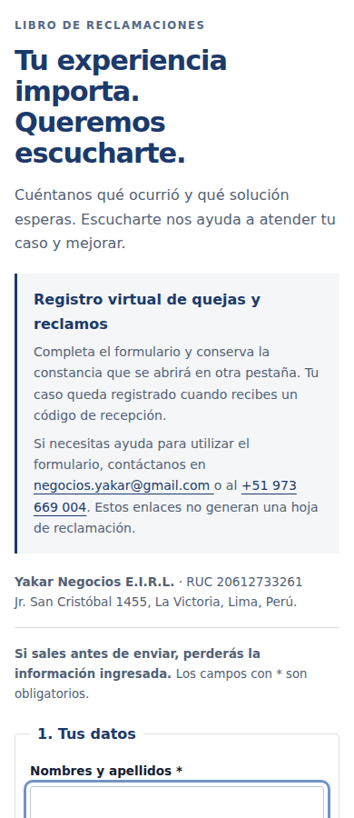
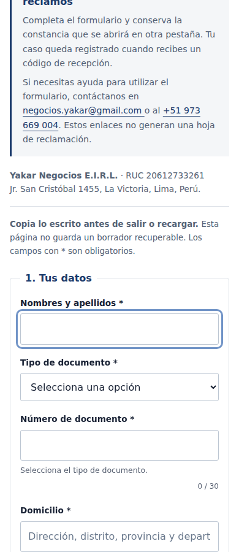
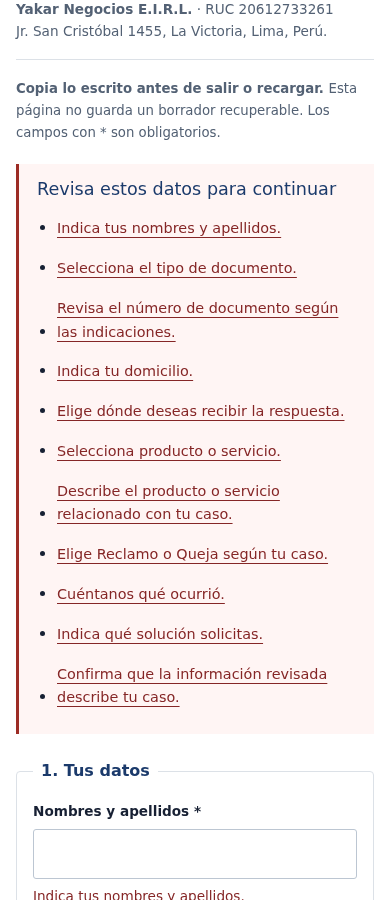

# Laboratorio del Libro y documentos de orientación — 21/10/2026

## Qué se revisó

Recorrido del Libro de Reclamaciones, Privacidad del Libro, Integridad y Método. Base: [d258ab9](https://github.com/yakarnegocios/yakar-web/tree/d258ab95b5b57f66ed9b993beb5eda95942db601), que conserva la edición anterior. Continúa el [laboratorio del primer requerimiento](../laboratorio-requerimientos-2026-10-21/README.md).

La pregunta de revisión fue la misma: ¿se entiende qué hacer, qué información se pide, cómo corregir y cómo conocer el resultado? Un primer contacto comercial y una hoja de reclamación tienen finalidades distintas. Se conservan los campos, las reglas de identificación y los controles de seguridad. La copia de lo escrito se distingue de la constancia del servidor.

Es revisión asistida con sesiones ficticias, no una certificación legal ni una investigación con clientes reales. Se utilizó la [orientación oficial de Indecopi](https://consumidor.gob.pe/libro-de-reclamaciones/), consultada el 21/10/2026, como referencia sobre estructura, datos y seguimiento del Libro. No se alteró el plazo de respuesta publicado ni se dedujeron obligaciones adicionales a partir del laboratorio.

## Hallazgos y cambios

| Punto | Evidencia anterior | Mejora comprobada |
|---|---|---|
| Información requerida | Formulario dividido en datos del consumidor, producto/servicio, hechos/pedido y revisión; representante condicional | Se conserva la estructura y la obligatoriedad anterior. Correo depende del medio de respuesta; los campos del representante se activan al marcar menor de edad |
| Validación | La validación nativa mostraba primero un campo; los textos de solo espacios podían llegar al intento de envío | Lista de errores al inicio, enlaces al campo, mensajes asociados, foco y rechazo de campos requeridos compuestos solo por espacios. Se siguen comprobando las restricciones HTML existentes |
| Copia personal | No había una herramienta para conservar el texto antes de recargar | «Copiar lo escrito», con alternativa de selección manual si el navegador no permite el portapapeles. No copia tokens de seguridad ni referencias técnicas. Se informa que no es una constancia |
| Historial del navegador | Los listeners de pagehide y pageshow reiniciaban campos e identificador | Se retira ese borrado automático. Una restauración desde la memoria del historial conserva datos e intento y renueva la seguridad. No hay recuperación garantizada tras cerrar o recargar ni se agrega almacenamiento persistente |
| Texto largo | «Necesito más espacio» ampliaba el límite, manteniendo el mismo alto de texto | Amplía también las filas visibles. Un formulario nuevo restablece filas, límite y confirmación |
| Seguridad y recuperación | Con fallo inicial del verificador, la orientación era recargar solo si no se había escrito | Ahora orienta a copiar lo escrito antes de recargar y a solicitar asistencia si continúa el problema. Se conserva el bloqueo ante token ausente, vencido o fallido |
| Reintentos | Identificador y datos congelados después del intento; resultado en otra pestaña | Se conserva y prueba este comportamiento. El mismo intento mantiene los datos y requiere renovar la verificación; el navegador sigue sin declarar recepción |
| Pestaña de respuesta | La página indicaba que la respuesta se abriría en otra pestaña | Se añade orientación sobre pestañas bloqueadas y se insiste en comprobar la constancia con código |
| Privacidad | No explicaba la nueva copia voluntaria | Versión 1.4, fecha real 21/10/2026: explica que conservar el texto por cuenta propia no registra ni reemplaza la constancia. Su alcance continúa siendo el Libro |
| Integridad | axe detectó contraste insuficiente en el párrafo de Filosofía NX del pie; heredaba el gris general sobre fondo oscuro | Color claro explícito coherente con el pie. No se cambia el compromiso comercial ni el contenido normativo |
| Método | Se comprobó como documento de orientación del cliente | Se conserva contenido y diseño: no se detectó en estas pruebas una corrección que requiriera modificarlo |

«Copiar lo escrito» prepara una copia local por decisión del usuario. No envía datos a YAKAR, no genera código oficial y no registra un reclamo. El endpoint, nombres de campos, sitekey, action de Turnstile y política de reintento permanecen como estaban. No hay cambios en Google Apps Script, Supabase, permisos, cuentas ni sistema interno.

## Evidencias

- [Antes](antes.json): al simular pageshow con `persisted=true`, el campo escrito quedaba vacío y cambiaba el identificador.
- [Después](despues.json): conserva el texto y el mismo intento, con token renovado/requerido.
- **19 comprobaciones funcionales**, con escenarios de identidad, correo por canal, representante, texto largo, copia correcta/denegada, monto inválido, verificación fallida/vencida, reintento y limpieza cancelada/confirmada.
- Dos POST se interceptaron y respondieron **exclusivamente dentro del laboratorio**. No se realizó ninguna petición de registro al servidor real. Se comprobó que los campos se incluyen en el POST aunque la interacción esté bloqueada mediante inert; esa propiedad no los excluye del envío.
- **16 combinaciones** de cuatro documentos y anchos 320, 390, 768 y 1280 px sin desbordamiento horizontal; controles móviles comprobados.
- axe no detectó infracciones automáticas en los cuatro documentos después del ajuste de Integridad. Dejó una comprobación de contraste por capas en Integridad para revisión manual; no se afirma conformidad total con WCAG por el resultado de una herramienta.
- Regresión general de **25 combinaciones de cinco páginas/ancho**, con menú, foco, movimiento reducido, controles e imagen responsive, correcta. [web-results.json](web-results.json).
- Sintaxis HTML/JavaScript y referencias internas correctas. [enlaces.json](enlaces.json).

| Estado anterior | Estado nuevo |
|---|---|
|  |  |



Las identidades usadas son ficticias; las capturas WebP conservan sin pérdida los píxeles del laboratorio.

## Límite que queda abierto

No se accedió al código ni a los registros del Google Apps Script activo. No se comprobó creación de hoja real, numeración, persistencia, impresión de constancia, entrega de correo, validación del token en el servidor ni eliminación de duplicados en el servidor. La respuesta de la prueba es una página que dice «laboratorio aislado; sin registro ni constancia», no una constancia simulada con aspecto oficial.

Para cerrar ese recorrido hace falta un entorno de ensayo del receptor, con código/despliegue identificables y datos de prueba separados del Libro real. Revisión técnica y Gerencia Operativa deben comprobar allí: aceptación válida, rechazo seguro, misma referencia en reintento, recuperación del resultado, constancia imprimible y entrega de la copia que corresponda. Evidencia: referencia de ensayo y resultado persistente, sin exponer datos personales. No se puede sustituir esto por HTTP 200, un build ni un simulador del navegador.

La conducta de caché del historial depende del navegador. La prueba del handler de restauración no acredita conservación en todos los dispositivos físicos; por eso se sigue recomendando copiar antes de salir y no se promete un borrador recuperable.

## Reproducción

```bash
node tests/book-lab.cjs
node tests/mobile.cjs
python tools/check-links.py
html-validate --config tests/html-lab.json index.html metodo.html integridad.html privacidad.html reclamaciones.html
```

QA: Chromium 153, Playwright 1.62.1, axe-core 4.14.0 y html-validate 11.17.0, instalados en el entorno de laboratorio. No se entregan estas dependencias al visitante. Las pruebas aceptan `YAKAR_PLAYWRIGHT_PATH`, `YAKAR_CHROMIUM_EXECUTABLE`, `YAKAR_AXE_PATH` y `YAKAR_BOOK_REPORT_DIR`. El modo `--baseline` requiere `YAKAR_BOOK_BASE_FILE` apuntando al HTML de la base d258ab9 y registra su comportamiento anterior.

Turnstile es un doble local que solo existe en el test; todas las navegaciones externas se interceptan. Ningún doble, token de prueba ni excepción de seguridad se incorpora a la web publicada. Los resultados no acreditan superar ni comprobar el servicio real de Cloudflare.

La publicación y el cotejo posterior de los archivos públicos se registran en el PR del incremento, separados de las pruebas locales.
