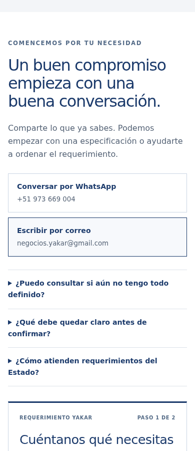
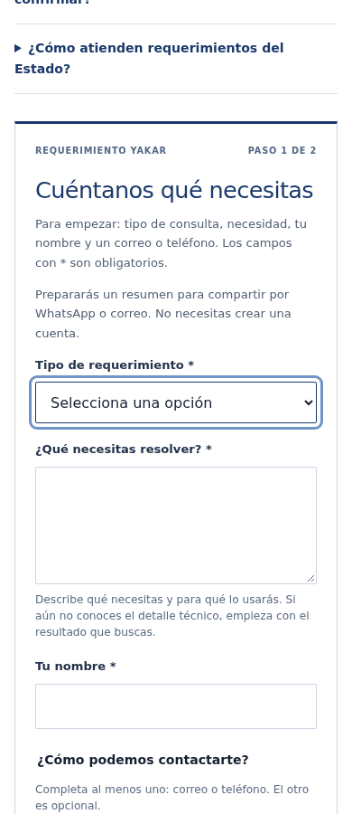
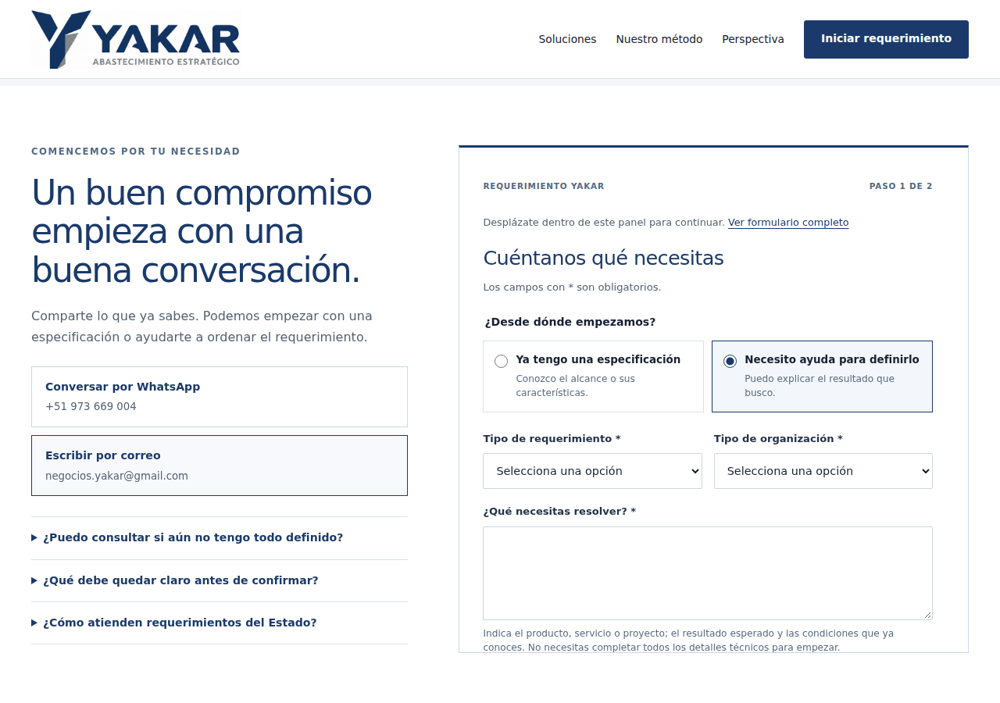
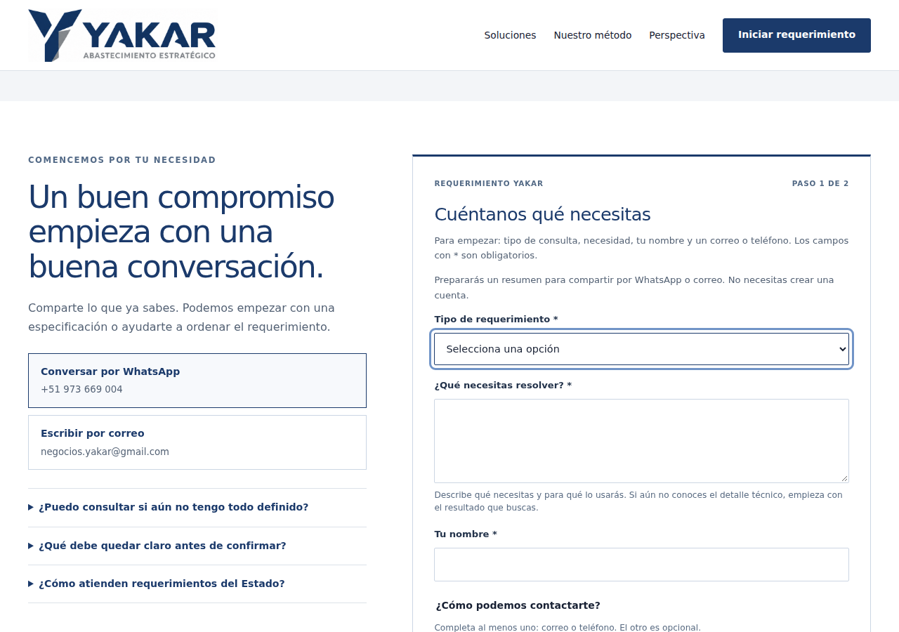

# Laboratorio del primer requerimiento — 21 de octubre de 2026

## Resultado y alcance

Se recorrió la web pública como visitante que desea consultar productos, servicios, proyectos o una necesidad aún sin definir. La presentación muestra identidad, contacto, método y condiciones; el principal obstáculo observable estaba en el esfuerzo para iniciar la conversación y entender el envío.

La edición anterior pedía seis campos obligatorios. La nueva pide tres campos (tipo de consulta, necesidad y nombre) más un medio de contacto: correo **o** teléfono. No se obliga a tener correo para consultar por WhatsApp. Empresa, cantidad, fecha y ubicación se pueden agregar, sin bloquear la primera consulta. La propuesta comercial posterior requiere precisar los datos y condiciones que correspondan a cada atención.

Son simulaciones técnicas y revisión asistida de experiencia/comercial, antropología, accesibilidad, calidad y seguridad. No son entrevistas con clientes, una certificación de accesibilidad ni una medición de conversión o satisfacción. No se enviaron consultas, no se crearon expedientes, no se usaron cuentas personales y no se modificó el sistema interno.

## Base y trazabilidad

- Base de `main`: [a9e040d](https://github.com/yakarnegocios/yakar-web/tree/a9e040d52cf6eaa0d2da41eba612e780715239be), conservada en Git.
- Antes de editar se contrastaron los archivos locales con sus blobs remotos. La portada pública respondió HTTP 200 y coincidió byte por byte con esa base.
- La revisión anterior permanece consultable en ese commit, incluidos HTML, estilos y JavaScript. Las capturas y mediciones anteriores se conservan junto a las nuevas.
- La publicación y cotejo posterior de GitHub Pages se registran en el PR del incremento. Un merge por sí solo no acredita publicación.

## Hallazgos y decisiones

| Mirada | Evidencia del recorrido anterior | Decisión aplicada / significado para YAKAR |
|---|---|---|
| Visitante nuevo | La llamada principal llevaba al bloque introductorio; en celular la primera pregunta quedaba debajo de la pantalla del punto de llegada | Llevar al inicio del formulario y enfocar el selector; conservar WhatsApp y correo directos como alternativas |
| Cliente que sabe qué necesita | Dos decisiones iniciales: especificación/ayuda y tipo de requerimiento; luego otra clasificación de organización | Conservar una clasificación útil: productos, servicios, proyectos u orientación; las entradas de cada solución la preseleccionan |
| Cliente que no sabe el detalle técnico | Aunque el texto permitía pedir orientación, se exigían organización y correo | Pedir solo información para iniciar la conversación; mostrar cantidades, fechas, empresa y ubicación como opcionales |
| Gestión comercial | Información técnica insuficiente para una propuesta definitiva | Separar primer contacto de propuesta: Gerencia Operativa precisará alcance, empresa, cantidades, entrega y condiciones con el cliente antes de cotizar |
| Celular y computadora | En escritorio había un panel de 650 px con desplazamiento interno | Usar el desplazamiento de la página en ambos tamaños; campos legibles y ayudas junto a la pregunta |
| Errores y recuperación | La validación nativa interrumpía en el primer campo; la edición del resumen se reconstruía al volver | Lista de errores con enlaces y foco, mensajes asociados al campo, conservar datos y edición manual del resumen si el formulario no cambió |
| Expectativa de envío | El usuario debía interpretar qué significaba preparar/copy/abrir una aplicación | Dos pasos explícitos: preparar y revisar/compartir. Abrir una aplicación nunca se presenta como recepción |
| Adjuntos | No hay carga de archivos en esta página estática | Explicar que se pueden adjuntar fotos o fichas desde WhatsApp o correo al enviar; conservar copia como alternativa si un enlace largo no abre completo |
| Claridad sobre los datos | El enlace de privacidad del requerimiento llevaba a información específica del Libro de Reclamaciones | Explicación propia del funcionamiento de esta consulta: preparación local, servicio externo elegido y ausencia de borrador recuperable. El Libro y su información conservan su alcance |
| Accesibilidad | Texto ampliado al 200% desbordaba palabras del título y del encabezado del requerimiento | Permitir ajuste de palabras en encabezados; reforzar fondo de texto sobre fotografía y semántica de grupos |
| Acceso del equipo | Tres páginas conservaban el enlace anterior de acceso privado | Unificar con el destino que ya usaban portada e Integridad. Respuesta HEAD no acredita ingreso ni permisos de una persona |
| Mantenimiento | Solo el CSS tenía versión por contenido | Versionar también el JavaScript para evitar mezclar el formulario nuevo con una interacción antigua en caché |

La identidad empresarial, las imágenes identificadas como ilustrativas y el detalle de condiciones son señales de confianza observables. No se infiere experiencia, capacidad operativa, stock, certificaciones ni conformidad legal a partir de la apariencia. La oferta amplia y la claridad del vocabulario deben validarse con clientes representativos; no se inventan puntuaciones de percepción.

## Protocolo de preguntas

| Pregunta | Uso inmediato | Tratamiento |
|---|---|---|
| Tipo de consulta | Dirigir la conversación | Obligatoria; orientación es una respuesta válida |
| Qué necesita / resultado | Comprender el problema | Obligatoria; admite información técnica incompleta |
| Nombre | Dirigir la respuesta | Obligatorio |
| Correo o teléfono | Disponer de un medio de contacto | Al menos uno; no se exigen ambos |
| Empresa | Identificar la organización cuando se conoce | Opcional en primer contacto; se precisa para preparar una propuesta |
| Cantidad / fecha / ubicación | Evaluar alcance y condiciones | Opcionales; no constituyen compromisos aceptados |
| Tipo de organización y especificación/ayuda | No resultaban indispensables para iniciar esta consulta | Eliminados del formulario; se aclaran en la conversación cuando sea pertinente |

No se agregan RUC, dirección legal, presupuesto, archivos obligatorios ni registro de cuenta al primer contacto. La mayor cantidad de preguntas no demuestra mejor calidad de atención.

## Evidencia antes y después

En la misma sesión simulada, viewport de 390 × 900, movimiento reducido y datos vacíos:

| Medida | Antes | Después |
|---|---:|---:|
| Campos inicialmente desplegados, sin contar la elección por radios | 10 | 5 |
| Campos obligatorios individuales | 6 | 3 + un correo o teléfono |
| Alto del formulario medido en laboratorio | 1707 px | 1197 px |
| Desplazamiento interno a 1280 px | Sí | No |
| Primera pregunta tras entrar desde la portada | Fuera del primer viewport en la medición | Dentro del viewport y con foco |

Son medidas de interfaz, no tiempos humanos, porcentajes de mejora comercial ni resultados de clientes reales. Los datos brutos están en [antes.json](antes.json) y [despues.json](despues.json).

| Celular antes | Celular después |
|---|---|
|  |  |

| Computadora antes | Computadora después |
|---|---|
|  |  |

Las capturas WebP conservan los píxeles del PNG de laboratorio mediante compresión sin pérdida.

## Comprobaciones realizadas

- **25 comprobaciones de recorrido**: categorías, información mínima, detalles opcionales, fecha, corrección, datos conservados, resumen editable, errores, navegación por teclado, copia correcta/denegada, enlaces y destinatarios, texto largo/acentos/símbolos/HTML tratado como texto, ausencia de envío automático, almacenamiento y peticiones externas durante la preparación, ausencia de JavaScript y giro de pantalla.
- **Cinco anchos del recorrido**, de 320 a 1280 px. Sin desbordamiento horizontal ni panel con desplazamiento anidado.
- **25 combinaciones página/ancho** de las cinco páginas públicas: reflujo, campos móviles de 16 px, controles, menú/Escape/foco, movimiento reducido e imagen responsive DPR2. La prueba mide controles visibles mediante `checkVisibility`, evitando confundir contenido de un details cerrado con campos desplegados.
- Texto relativo ampliado al **200% a 390 px**, sin desbordamiento horizontal en el caso comprobado. No equivale a una prueba en todos los sistemas de ampliación.
- **axe**: sin infracciones automáticas detectadas en formulario, errores y revisión. En página completa tampoco detectó infracciones; dejó comprobaciones de contraste sobre imagen/capas para revisión adicional. El cálculo suplementario comprobó los colores de hitos y el peor fondo blanco detrás del panel semitransparente de la fotografía; los cocientes medidos constan en el JSON. La inspección de capturas complementa la herramienta, sin certificar todos los criterios WCAG.
- Sintaxis JavaScript correcta. HTML: reglas de orden de cierre, IDs duplicados y atributos requeridos correctas en cinco páginas, con `tests/html-lab.json`.
- **105 referencias internas** y anclas comprobadas. [enlaces.json](enlaces.json) y `tools/check-links.py`.
- **16 destinos externos** respondieron a HEAD. [enlaces-externos.json](enlaces-externos.json). No se abrió WhatsApp ni se probó autenticación del sistema; un 200 de HEAD no acredita el contenido ni el recorrido de un tercero.

## Reproducción

Node 24 y Chromium 153 en el laboratorio. Dependencias de QA: Playwright 1.62.1, axe-core y html-validate; están separadas del código que se entrega al visitante. Instalar las herramientas de QA en el entorno de comprobación, no añadirlas al navegador del cliente.

```bash
python tools/version-styles.py
node --check js/main.js
python tools/check-links.py
html-validate --config tests/html-lab.json index.html metodo.html integridad.html privacidad.html reclamaciones.html
node tests/request-lab.cjs
node tests/mobile.cjs
```

Las pruebas de navegador aceptan `YAKAR_PLAYWRIGHT_PATH` y `YAKAR_CHROMIUM_EXECUTABLE` para dependencias/binary de QA existentes. `YAKAR_AXE_PATH` debe apuntar a `axe.min.js` para incluir su revisión; `YAKAR_REQUEST_REPORT_DIR` y `YAKAR_MOBILE_REPORT_DIR` guardan resultados y capturas. No configurar credenciales ni una base de datos: las acciones externas se interceptan y las identidades son ficticias.

## Límites y siguiente comprobación útil

No se midieron satisfacción, conversión, recurrencia, tiempo de respuesta real, entrega efectiva de mensajes, lectores de pantalla con personas ni dispositivos físicos Safari/iOS. Los enlaces contienen el texto íntegro en laboratorio; una aplicación externa puede imponer límites o no estar instalada, por eso se mantiene copiar/pegar y contacto directo.

Para el cierre comercial, Ernesto, **Gerente Operativo**, puede revisar tres primeras consultas reales, con la información mínima necesaria, y registrar: ¿se entendió la necesidad?, ¿fue posible responder?, ¿qué dato faltó para cotizar? Indicador: consultas que pasan a una conversación útil, con evidencia de respuesta y próximo paso. No se propone sumar un rastreador ni ampliar el formulario sin esa evidencia.

Después de enviar el mensaje, el registro y seguimiento interno siguen el proceso autorizado de YAKAR; este formulario no crea un expediente ni un código oficial automáticamente. La prueba de Yanina y de cada usuario interno se realiza por separado, en su propia sesión.

## Referencias de diseño consultadas el 21/10/2026

- [W3C WAI — Forms Tutorial](https://www.w3.org/WAI/tutorials/forms/): pedir solo información necesaria y ofrecer instrucciones y revisión.
- [W3C WAI — User Notification](https://www.w3.org/WAI/tutorials/forms/notifications/): errores claros, asociados a controles y con orientación.
- [GOV.UK Design System — Check answers](https://design-system.service.gov.uk/patterns/check-answers/): revisar y corregir conservando respuestas anteriores.

Son guías de diseño utilizadas para el criterio técnico, no obligaciones legales atribuidas a YAKAR.
