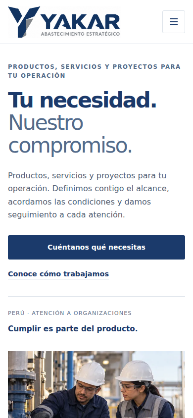

# Web YAKAR: diagnóstico, propuesta e implementación móvil

Fecha: 21/10/2026. Base de publicación: `70e6e43f70b8577440319c587d232dbd23c82200`. Alcance: presentación y carga; sin alterar contenido comercial, condiciones legales, envío de formularios o datos del sistema.

## Evidencia y cambios

Se inspeccionaron inicio, método, integridad, privacidad y reclamaciones en 320, 360, 390 y 768 CSS px. La prueba permanente añade 1280 px como control de escritorio. Chromium 153 con emulación táctil; no se enviaron formularios.

| Prioridad | Hallazgo | Mejora aplicada | Evidencia posterior |
|---|---|---|---|
| Alta | Portada: 12 campos visibles con fuentes de 13,12 o 14,4 px | Fuente de 16 px en formularios y filtros del calendario hasta 900 px | Ningún campo visible inferior a 16 px en las páginas y anchos móviles ensayados |
| Alta | PNG de portada 1.946.998 bytes + identidad 1.890.997 bytes | Portada WebP con srcset de 768/1152/1536 px y sizes explícito; logo web sin pérdida con solo el área ya visible | En 390 px y DPR2 se selecciona portada de 1152 px: 64.868 bytes + logo 100.792 bytes = 165.660 bytes, frente a 3.837.995 (−95,7 %) |
| Media | Desplegables de Perspectiva de 35 px y botones auxiliares de reclamaciones de 36 px | Altura de 44 px para esos controles en móvil | Ningún botón o summary visible inferior a 44 px en las 20 combinaciones móviles |
| Conservación | No se observó scroll horizontal de página antes del cambio | Mantener estructura y comprobar de nuevo, sin ocultar desbordamientos con overflow-x:hidden | Cero desbordamientos a 320/360/390/768 y control a 1280 px |

La reducción indicada corresponde exclusivamente a esas dos imágenes; no es una medición del peso total, LCP o ahorro de datos de una visita real. La red, caché y densidad del dispositivo pueden variar. No se inventa un puntaje de rendimiento.

## Antes y después, 390 px

| Antes | Después |
|---|---|
|  |  |

[Mediciones anteriores](before.json) · [Mediciones posteriores](after.json).

## Calidad de la identidad e imágenes

El logo no se redibuja ni se convierte en un nuevo master de marca. Se conserva exactamente el recorte que el CSS ya mostraba: origen 1448 × 1086, rectángulo (620,149)–(1390,365), salida 770 × 216. El WebP se codifica sin pérdida y se comprobó igualdad de píxeles con ese recorte. Se retiran desplazamientos CSS de imagen innecesarios. Los archivos PNG originales permanecen disponibles para recuperación.

La portada conserva encuadre y contenido, con variantes comprimidas y dimensiones declaradas para reservar espacio. El navegador elige el recurso; no se añade JavaScript para detectar dispositivos ni se crea una segunda web móvil.

Regeneración: `python tools/optimize-images.py` con Pillow. El script se detiene si cambian las dimensiones de los originales, para no aplicar ciegamente un recorte a otra identidad.

## Criterios y prácticas sostenibles

- Reflujo a 320 CSS px como criterio de revisión, según [W3C 1.4.10](https://www.w3.org/WAI/WCAG22/Understanding/reflow.html).
- Objetivo interno de 44 px de alto para controles principales. [WCAG 2.5.8](https://www.w3.org/WAI/WCAG22/Understanding/target-size-minimum) establece 24 × 24 px o excepciones de espaciado; no se presenta 44 px como obligación general.
- Menú existente: apertura, Escape y devolución del foco comprobados. Se mantiene el zoom del navegador.
- Movimiento reducido comprobado; sin nuevos rastreadores, fuentes externas, librerías de interfaz ni peticiones recurrentes.
- CSS versionado por hash de contenido para evitar mezclar imágenes nuevas con estilos antiguos en caché. Tras editar CSS: `python tools/version-styles.py`; la prueba móvil exige que la referencia coincida.
- CSS compartido y ajustes delimitados a pantalla móvil; contenido y presentación de escritorio conservados. No se cambia ni oculta texto legal.
- Fuentes y pruebas versionadas para detectar regresiones. La revisión visual no equivale a certificación de accesibilidad.

## Prueba reproducible

Instalar Playwright 1.62.1 en un entorno de validación y preparar Chromium. Ejecutar `node tests/mobile.cjs`; puede usarse `YAKAR_PLAYWRIGHT_PATH` para un entorno externo y `YAKAR_CHROMIUM_EXECUTABLE` para una distribución compatible. El test inspecciona 25 combinaciones, menú/Escape/foco, movimiento reducido y selección responsive en DPR2. No escribe ni envía reclamaciones o requerimientos.

Pendiente: dispositivo físico con Safari/iOS y Chrome/Android, teclado virtual y medición de rendimiento de campo. No se atribuyen a esos entornos las pruebas de Chromium. La integración, GitHub Pages y comprobación pública posterior se registrarán en el PR; este documento no anticipa su resultado.
